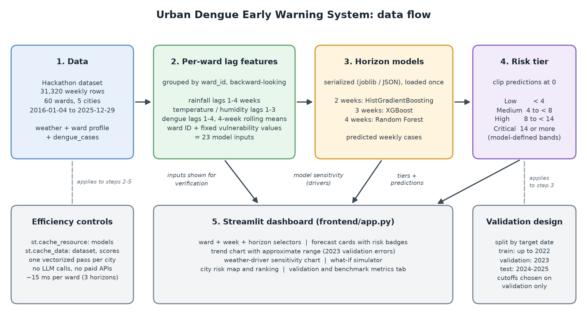

# Architecture

**Urban Dengue Early Warning System** (EDU AI Engineering Hackathon 2026, AI for Urban Dengue Outbreak)

A ward-level prototype that predicts dengue cases 2, 3 and 4 weeks ahead from weather lags, recent
case counts and fixed ward vulnerability, and labels each forecast Low, Medium, High or Critical.
It is a decision-support prototype, not a clinically validated or official surveillance system.

## 1. System architecture and data flow

1. **Data.** The hackathon dataset: 31,320 weekly rows, 60 wards in 5 cities, 2016-01-04 to
   2025-12-29. Its provenance is unverified, so we call the rows *dataset records*.
2. **Feature pipeline.** Per-ward lag features, described in section 2.
3. **Models.** One model per horizon, serialized with `joblib` (the 3-week XGBoost model is stored
   as JSON plus a separate preprocessor file). They are loaded once and never retrained at runtime.
4. **Risk tiers.** Predictions are clipped at zero and mapped to tiers (section 4).
5. **Dashboard.** A Streamlit app that calls `ml/predict.py` directly: forecast cards, trend chart
   with an approximate range, weather-driver chart, what-if simulator, city map and ranking, and a
   metrics tab.

## 2. Weather lag pipeline

Rain does not cause cases the next day. The hackathon brief describes a 7 to 14 day mosquito
development period followed by virus incubation and symptom onset, which creates a 2 to 4 week
delay between rain events and hospital spikes. The model therefore uses multi-week lags computed
**within each `ward_id`** (grouped lags), looking only backwards.

| Input group | Definition (for ward w at week t) |
|---|---|
| Rainfall lags | `rainfall_lag_k` = rainfall in week t-k, k = 1..4 |
| Rainfall rolling mean | mean of rainfall in weeks t-4 .. t-1 |
| Temperature / humidity lags | `temp_lag_m`, `humidity_lag_m`, m = 1..3 |
| Dengue history | `dengue_lag_k` = cases in week t-k (k = 1..4), plus the mean of weeks t-4 .. t-1 |
| Current-week weather | temperature, rainfall and humidity of week t |
| Ward profile | `ward_id` plus fixed `population_density_sqkm`, `water_logging_risk_index`, `sanitation_score` |

That is **23 model inputs** (82 columns after one-hot encoding `ward_id`). The targets are the
cases in weeks t+2, t+3 and t+4, one model each.

The cases of week t itself are not an input; the latest case count used is week t-1. This was a
design choice, and a test confirmed it costs little: adding the week-t count changed validation
MAE from 1.207 to 1.199 (about 0.6%), so it was left out.

## 3. Chronological validation

A random split would let the model train on weeks that come after the weeks it is tested on. We
split by the **date of the target week** instead.

| Set | Target dates | Rows per horizon | Used for |
|---|---|---:|---|
| Train | up to 2022-12-31 | about 21,500 | fitting models |
| Validation | 2023 | 3,120 | choosing between models, choosing the risk cutoffs, error ranges |
| Test | 2024-01-01 to 2025-12-29 | 6,300 | final reporting only |

**Rolling-origin check.** For each year from 2019 to 2025 we trained on all earlier years and
tested on that year (2-week XGBoost model). It beat the persistence baseline (predict last week's
count) in all seven years, with 40% to 55% lower MAE.

**Known limits of this validation.** Neighbouring weeks have overlapping forecast windows, and no
gap (embargo) was left at the split boundaries, so scores may be slightly optimistic. Cutoffs were
tuned on one validation year (2023), which had more high-case weeks than the test years.

## 4. Models, risk tiers and results

**Selection.** Models were compared on validation data with the same features, split and metrics.
At 2 weeks, HistGradientBoosting (validation MAE 1.198) and XGBoost (1.207) were tied within noise,
Random Forest scored 1.227 and a small neural network (MLP) 1.267. At 3 weeks XGBoost (1.196)
beat Random Forest (1.345); at 4 weeks Random Forest (1.493) beat XGBoost (1.592). Tree ensembles
suit this small tabular dataset (about 21,500 training rows); classical time-series models such as
ARIMA were not benchmarked in the time available.

| Horizon | Model | Test MAE | Test RMSE | Persistence MAE | MAE reduction |
|---|---|---:|---:|---:|---:|
| 2 weeks | HistGradientBoosting | 1.07 | 2.09 | 1.87 | 42.5% |
| 3 weeks | XGBoost | 1.15 | 2.26 | 2.06 | 44.1% |
| 4 weeks | Random Forest | 1.32 | 2.50 | 2.22 | 40.5% |

MAE and RMSE are errors in cases per ward per week; they are not accuracy percentages. A seasonal
baseline (mean of three weeks one year earlier) scores MAE 1.44 at 2 weeks on the test period.

**Risk tiers** apply to predicted weekly cases: Low below 4, Medium 4 to below 8, High 8 to below
14, Critical 14 or more. The 8 and 14 cutoffs were chosen on validation data to balance catching
high-case weeks against false alarms (regression models under-predict peaks, so the cutoffs sit
below the real 10 and 20 case bands). The Medium cutoff of 4 is untuned. These are model-defined
bands, not official public-health thresholds.

**Alert quality (test).** At the High cutoff the models flagged about 72% to 75% of the weeks that
really had 10 or more cases, but only about 40% to 46% of those alerts were correct. The test
years were quiet (15 weeks with 20 or more cases), so Critical-tier results are statistically
fragile.

## 5. Compute and API cost efficiency

| Control | How it works |
|---|---|
| Serialized local models | `joblib` and JSON files; inference runs in plain Python on a CPU, with no GPU, server or Docker needed |
| Load once | `st.cache_resource` loads the models once per server run; `st.cache_data` keeps the dataset, ward table and city scores |
| No repeated inference | City scoring builds one feature table and calls each model once per horizon instead of looping over wards |
| Precomputed medians | The dataset-wide medians used by the driver analysis are stored in `ml/feature_medians.json` |
| No LLM or paid API calls | Driver explanations and the recommendation text are computed or written ahead of time; no LLM tokens are used |
| Network use | Only a one-time dataset download (if `data/` has no file) and map tiles loaded by the browser from OpenStreetMap |

**Measured speed** (cloud CPU): about 15 ms for one ward at all three horizons including feature
building (single-row model calls take roughly 3 to 7 ms each), and about 50 ms for the 20 wards of
Dhaka North, of which about 10 ms is model inference.

## 6. What drives the predictions, and limitations

Feature-removal test (2-week XGBoost, validation MAE; higher is worse):

| Variant | MAE | Change |
|---|---:|---:|
| All 23 inputs | 1.207 | reference |
| Without `rainfall_lag_1` | 1.345 | +11% |
| Without all rainfall features | 1.694 | +40% |
| Without all weather features | 2.374 | +97% |
| Without dengue history | 1.213 | +0.5% |

The forecasts depend mainly on weather inputs, and recent case counts add almost nothing. That
pattern is unusual for real surveillance data, which is one reason we make no real-world claims.
The weather-driver chart measures how the trained model responds when a group of inputs is
replaced by typical values; it shows model sensitivity, not cause and effect.

**Limitations.**

- Dataset provenance and licence are unverified; results describe this dataset only.
- Ward vulnerability values never change over time, so the model cannot learn how changing them
  would affect dengue, and wards outside the 60 cannot be scored.
- The model has no month or week-of-year input, so rainfall may partly stand in for the season.
- There is no live weather source; forecasts use dataset records for the selected week.
- The map uses approximate ward positions, because the dataset contains no coordinates.
